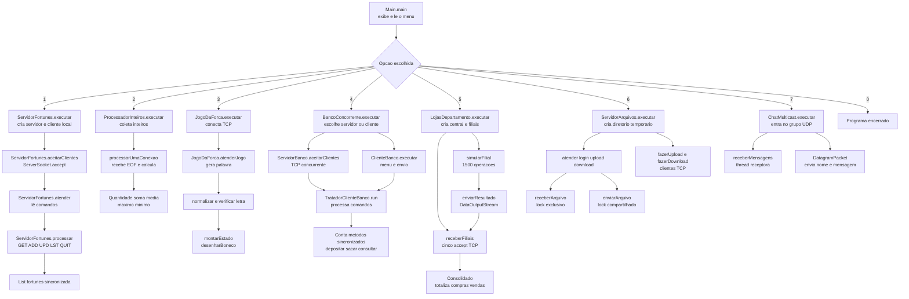

# Trabalho de Sistemas Distribuidos com Sockets

## Visao Geral

Este projeto implementa uma coletanea de sete atividades de Sistemas Distribuidos usando sockets Java. O problema proposto envolve trocar dados entre processos por rede, tratando TCP, UDP, concorrencia, sincronizacao e protocolos textuais ou binarios. A solucao oferece um menu principal em `Main` e modulos independentes para servidor de fortunes, processamento de inteiros, jogo da forca, banco concorrente, consolidação de lojas, servidor de arquivos e chat multicast.

## Tecnologias e Ferramentas

- Java SE e JDK 8 ou superior
- API de rede Java:
  - `ServerSocket` e `Socket` para TCP
  - `DataInputStream` e `DataOutputStream` para dados binarios
  - `DatagramPacket` e `MulticastSocket` para UDP multicast
- Concorrencia Java:
  - `ExecutorService`, `Thread` e `Future`
  - `synchronized`, `AtomicBoolean`, `AtomicInteger`
  - `ReentrantReadWriteLock`
- Entrada e saida com `BufferedReader`, `PrintWriter` e `Scanner`
- UTF-8 para os protocolos textuais
- `BigInteger` e `BigDecimal` para calculos numericos sem perder precisao
- Sistema de arquivos Java NIO para upload, download e arquivos temporarios

## Como foi Solucionado (Resumo Tecnico)

O ponto de entrada é a classe `Main`, que mostra um menu numerado e chama o método estático `executar` do módulo escolhido. A opção 0 encerra o programa. As demais opções retornam ao menu quando o módulo termina.

### Exercício 1 - Servidor de fortunes

`ServidorFortunes.executar` cria um `ServerSocket` em porta dinâmica, inicia o servidor em uma thread aceitadora e abre um `Socket` cliente para `127.0.0.1`. `aceitarClientes` chama `accept` para cada conexão e usa um pool para executar `atender`. `atender` lê comandos UTF-8 linha a linha e delega o processamento a `processar`. `processar` implementa `GET-FORTUNE`, `ADD-FORTUNE`, `UPD-FORTUNE`, `LST-FORTUNE` e `QUIT`. As frases ficam em uma `List<String>` sincronizada. `close` fecha a porta e encerra as threads.

O projeto também contém `ServidorEx1` e `ClienteEx1` como implementação independente do mesmo protocolo na porta fixa `5001`. `ServidorEx1.main` atende clientes concorrentes em `atenderCliente`; `processarComando` mantém as mesmas regras de cadastro e consulta. `ClienteEx1.main` envia comandos pelo terminal.

### Exercício 2 - Processador de inteiros

`ProcessadorInteiros.executar` coleta inteiros no terminal e cria um `ServerSocket` em porta dinâmica. Uma thread executa `processarUmaConexao`, enquanto o método cliente envia cada inteiro em uma linha, chama `shutdownOutput` para sinalizar EOF e aguarda o resultado. `processarUmaConexao` lê até EOF, soma em `BigInteger`, calcula média decimal com `MathContext.DECIMAL64` e envia quantidade, soma, média, máximo e mínimo. Entradas inválidas são recusadas com uma mensagem de erro.

### Exercício 3 - Jogo da forca

`JogoDaForca.executar` inicia o servidor e o cliente TCP localmente. `atenderJogo` sorteia uma palavra, guarda letras acertadas e tentadas em conjuntos `HashSet`, permite até seis erros e envia estado por texto. `normalizar` remove acentos e transforma a entrada em letra simples. `montarEstado` substitui letras não reveladas por `_` e `desenharBoneco` cria a representação textual conforme o número de erros.

### Exercício 4 - Banco concorrente

`BancoConcorrente.executar` permite iniciar o servidor ou um terminal cliente. `ServidorBanco` abre `ServerSocket` na porta `5004` ou em uma porta informada, aceita conexões em `aceitarClientes` e entrega cada `Socket` a um `TratadorClienteBanco` executado em pool.

`Conta` representa uma conta com número e saldo em `BigDecimal`. Seus métodos sincronizados evitam perdas ou leitura inconsistente durante depósitos e saques. `depositarComHistorico` e `sacarComHistorico` verificam ou alteram o saldo dentro da mesma seção crítica. `TratadorClienteBanco` interpreta `DEPOSITO|conta|valor`, `SAQUE|conta|valor`, `SALDO|conta` e `SAIR`. `ClienteBanco.executar` apresenta o menu do terminal e usa `enviarComando` e `exibirResposta` para a troca TCP.

### Exercício 5 - Consolidação de lojas

`LojasDepartamento.executar` cria uma central TCP e cinco filiais em pools separados. `receberFiliais` aceita cinco conexões sequenciais com `accept`. Cada filial executa `simularFilial`, gera 1500 operações aleatórias de compras ou vendas com atraso curto e devolve um `ResultadoFilial`. `enviarResultado` serializa identificador, totais e quantidade com `DataOutputStream`. `receberFiliais` reconstrói os dados com `DataInputStream`, valida os valores e acumula um `Consolidado`.

### Exercício 6 - Servidor de arquivos

`ServidorArquivos.executar` cria um diretório temporário, inicia o servidor em porta dinâmica e demonstra primeiro `UPLOAD` e depois `DOWNLOAD`. `aceitarClientes` usa um pool para executar `atender` em cada conexão. `atender` exige `LOGIN` com `aluno` e `socket`, valida um nome simples e encaminha a operação.

`receberArquivo` limita o conteúdo a 50 MiB, adquire o lock exclusivo do arquivo, grava em arquivo temporário e usa `Files.move` para publicar o arquivo final. `enviarArquivo` adquire o lock compartilhado, envia tamanho, resposta e bytes pelo stream. `fazerUpload` e `fazerDownload` implementam o cliente da demonstração.

### Exercício 7 - Chat multicast

`ChatMulticast.executar` entra no grupo UDP `230.0.0.1`, porta `4446`, usando `MulticastSocket.joinGroup`. `receberMensagens` executa em uma thread dedicada, recebe `DatagramPacket` e imprime o conteúdo. O método principal serializa `nome: mensagem` em bytes UTF-8 e envia a cada pacote ao grupo. O comando `/sair` interrompe o envio e libera o participante com `leaveGroup`.

## Diagrama da Solução (com Funções)



## Como Executar

### Pré-requisitos

- JDK 8 ou superior
- Terminal com suporte a Java
- Para o chat multicast, rede com permissao para UDP multicast no grupo `230.0.0.1`

No Windows PowerShell, a partir da raiz do repositorio:

```powershell
New-Item -ItemType Directory -Force -Path out | Out-Null
javac -encoding UTF-8 -d out src\Main.java src\Exercicio01_ServidorFortunes\ServidorFortunes.java src\Exercicio01_ServidorFortunes\ServidorEx1.java src\Exercicio01_ServidorFortunes\ClienteEx1.java src\Exercicio02_ProcessadorInteiros\ProcessadorInteiros.java src\Exercicio03_JogoDaForca\JogoDaForca.java src\Exercicio04_BancoConcorrente\BancoConcorrente.java src\Exercicio04_BancoConcorrente\Conta.java src\Exercicio04_BancoConcorrente\ServidorBanco.java src\Exercicio04_BancoConcorrente\ClienteBanco.java src\Exercicio04_BancoConcorrente\TratadorClienteBanco.java src\Exercicio05_LojasDepartamento\LojasDepartamento.java src\Exercicio06_ServidorArquivos\ServidorArquivos.java src\Exercicio07_ChatMulticast\ChatMulticast.java
java -cp out Main
```

As opções 1, 2, 3, 5, 6 e 7 criam suas conexões localmente dentro da própria execução. Para testar o exercício 4 com concorrência real, execute `Main` em dois ou mais terminais. Em um terminal, escolha a opção 4 e depois 1 para iniciar o servidor. Nos outros, escolha 4 e depois 2 para iniciar clientes. Porta padrão do banco: `5004`.

Para executar separadamente o servidor e o cliente de fortunes da implementação fixa:

```powershell
java -cp out Exercicio01_ServidorFortunes.ServidorEx1
```

Em outro terminal:

```powershell
java -cp out Exercicio01_ServidorFortunes.ClienteEx1
```

O cliente de fortunes usa o endereço `127.0.0.1` e a porta TCP fixa `5001`.
