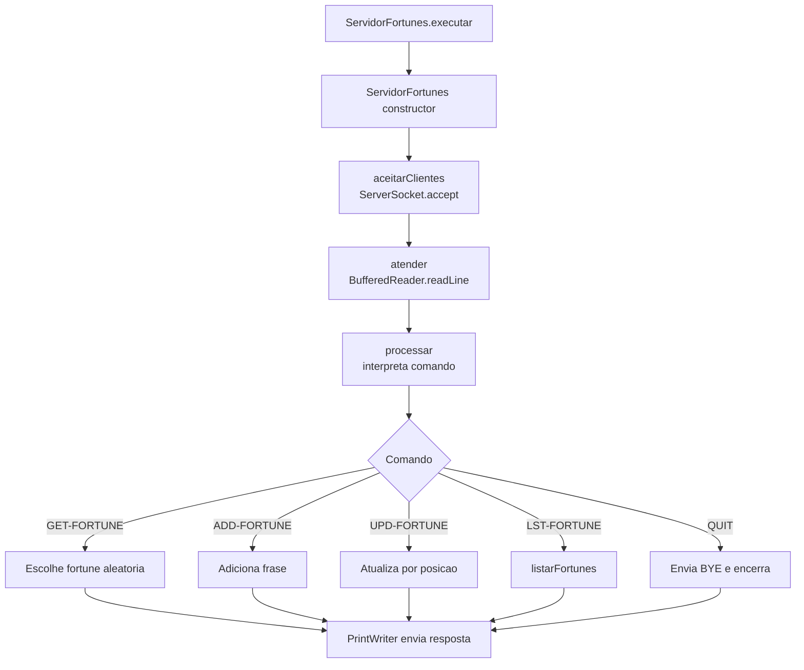

# Servidor TCP de Fortunes

## Visao Geral

Esta atividade implementa um servidor TCP que mantem uma lista de mensagens
de sorte e atende comandos enviados por clientes textuais. O objetivo é
demonstrar o modelo cliente-servidor, o atendimento concorrente e um protocolo
com base em linhas UTF-8.

## Tecnologias e Ferramentas

- Java SE e JDK 8 ou superior
- `ServerSocket`, `Socket` e streams TCP
- `BufferedReader` e `PrintWriter`
- UTF-8
- `ExecutorService` e threads concorrentes
- `Collections.synchronizedList`

## Como foi Solucionado (Resumo Tecnico)

`ServidorFortunes.executar` cria o servidor em uma porta dinâmica, inicia um
cliente TCP local em `127.0.0.1` e abre o terminal interativo. `aceitarClientes`
aguarda conexões com `ServerSocket.accept` e envia cada `Socket` para
`atender`, executado por uma thread do pool.

`atender` decodifica os dados recebidos como texto UTF-8 e lê uma linha por
comando. `processar` trata `GET-FORTUNE`, `ADD-FORTUNE`, `UPD-FORTUNE`,
`LST-FORTUNE` e `QUIT`. A lista é protegida por sincronização. `listarFortunes`
formata as frases com posições iniciando em 1. `close` encerra o servidor e o pool.

As classes `ServidorEx1` e `ClienteEx1` oferecem uma implementação separada na
porta fixa `5001`. `ServidorEx1.atenderCliente` atende cada cliente em uma
thread e `processarComando` implementa as mesmas regras. `ClienteEx1.main`
conecta ao servidor e envia os comandos digitados pelo usuário.

## Diagrama da Solucao (com Funcoes)



## Como Executar

Na raiz do repositório, compile:

```powershell
javac -encoding UTF-8 -d out src\Exercicio01_ServidorFortunes\*.java
java -cp out Exercicio01_ServidorFortunes.ServidorEx1
```

Em outro terminal, execute o cliente independente:

```powershell
java -cp out Exercicio01_ServidorFortunes.ClienteEx1
```

Também é possível iniciar a versão integrada pelo menu principal:

```powershell
javac -encoding UTF-8 -d out src\Main.java src\Exercicio01_ServidorFortunes\*.java
java -cp out Main
```

Escolha a opção `1` no menu. Na implementação fixa, use `127.0.0.1:5001`.
