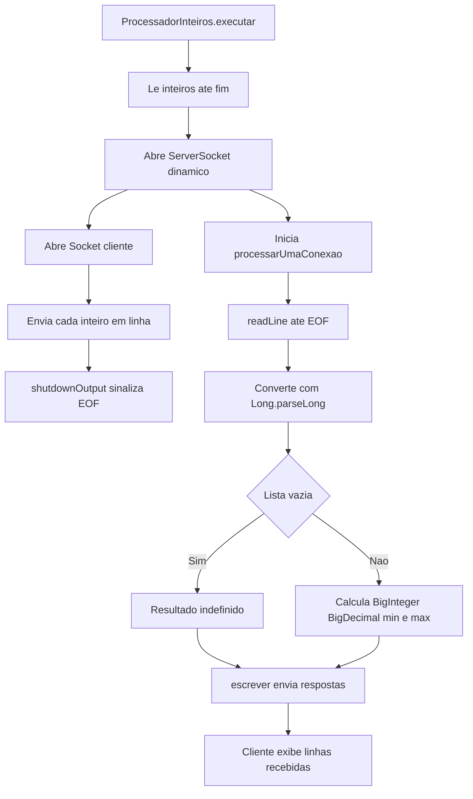

# Processador Distribuido de Inteiros

## Visao Geral

Esta atividade recebe uma sequência de inteiros por TCP e envia os dados a um
servidor que calcula estatísticas. O objetivo é demonstrar comunicação textual,
EOF de uma stream, tratamento de erros e cálculos com precisão ampliada.

## Tecnologias e Ferramentas

- Java SE e JDK 8 ou superior
- `ServerSocket` e `Socket`
- `BufferedReader` e `BufferedWriter`
- UTF-8
- `BigInteger` e `BigDecimal`
- Threads Java

## Como foi Solucionado (Resumo Tecnico)

`executar` coleta os números digitados pelo usuário até receber `fim`. Em seguida,
abre um `ServerSocket` em porta dinâmica e uma thread inicia
`processarUmaConexao`.

O cliente cria um `Socket` local, grava cada inteiro em uma linha e chama
`shutdownOutput` para indicar o fim da sequência sem fechar a leitura da resposta.
O servidor usa `readLine` até EOF, transforma os textos em `long` e guarda os
números válidos em uma `List<Long>`.

Se não houver números, o servidor retorna quantidade zero e resultados
indefinidos. Caso contrário, soma os valores em `BigInteger`, calcula mínimo,
máximo e média em `BigDecimal` com `DECIMAL64`. `escrever` envia cada linha de
resultado ao cliente.

## Diagrama da Solucao (com Funcoes)



## Como Executar

Na raiz do repositório:

```powershell
javac -encoding UTF-8 -d out src\Main.java src\Exercicio02_ProcessadorInteiros\ProcessadorInteiros.java
java -cp out Main
```

Escolha a opção `2` no menu principal.
