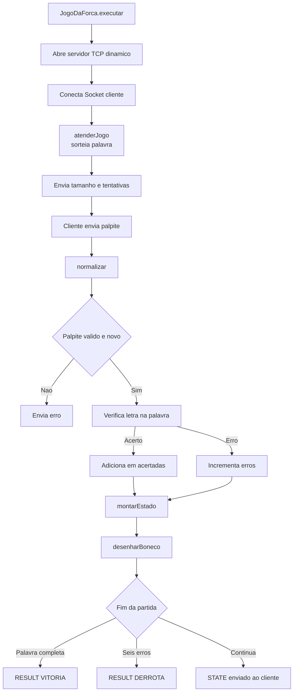

# Jogo da Forca via TCP

## Visao Geral

Esta atividade implementa um jogo da forca remoto em que o cliente envia
tentativas e o servidor mantém a palavra secreta e o estado da partida. O
objetivo é demonstrar interação TCP baseada em mensagens textuais e estado
mantido no servidor.

## Tecnologias e Ferramentas

- Java SE e JDK 8 ou superior
- `ServerSocket` e `Socket`
- `BufferedReader` e `PrintWriter`
- UTF-8
- `HashSet` para letras usadas e acertadas
- `Normalizer` para remover acentos
- `ThreadLocalRandom`

## Como foi Solucionado (Resumo Tecnico)

`executar` abre um servidor TCP local em porta dinâmica e um cliente TCP para
`127.0.0.1`. `atenderJogo` sorteia uma palavra de `PALAVRAS`, cria dois
`HashSet<Character>` e define `MAX_ERROS` como 6.

Após receber a primeira mensagem do servidor, o cliente envia uma letra por
vez. `normalizar` converte a entrada para minúsculas e remove marcas diacríticas.
O servidor rejeita entradas com mais de um caractere, letras já tentadas e
caracteres não alfabéticos.

Um acerto é registrado em `acertadas`; um erro incrementa o contador. `montarEstado`
formata a palavra revelada e `desenharBoneco` mostra partes adicionais conforme
os erros. Ao completar a palavra ou atingir seis erros, o servidor envia
`RESULT VITORIA` ou `RESULT DERROTA`.

## Diagrama da Solucao (com Funcoes)



## Como Executar

Na raiz do repositório:

```powershell
javac -encoding UTF-8 -d out src\Main.java src\Exercicio03_JogoDaForca\JogoDaForca.java
java -cp out Main
```

Escolha a opção `3`. O programa usa uma conexão integrada com cliente e servidor locais.
