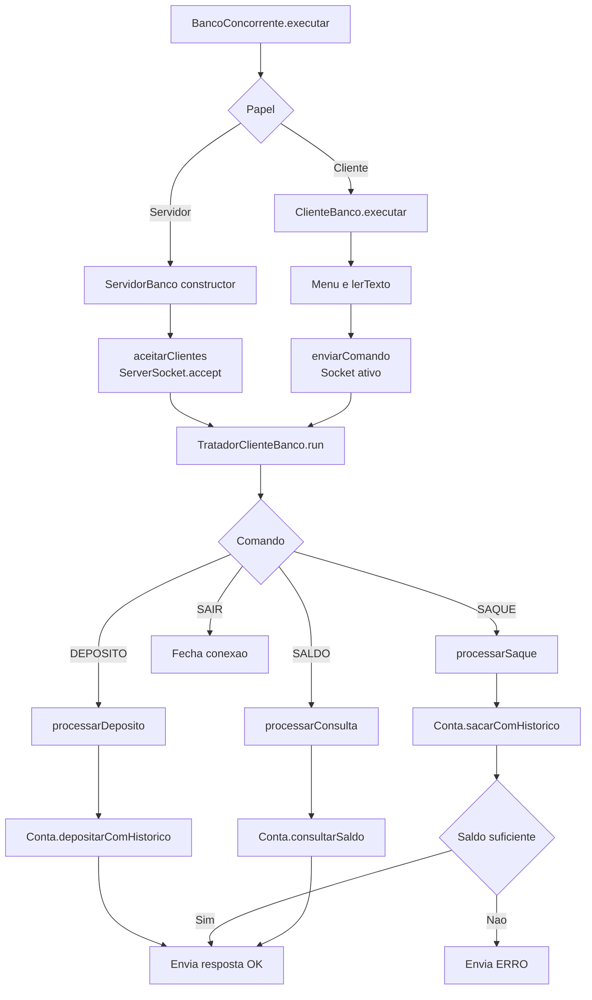

# Banco Concorrente via TCP

## Visao Geral

Esta atividade oferece um servidor bancário concorrente e um ou mais clientes
TCP. O problema tratado é manter operações consistentes de depósito, saque e
consulta em contas compartilhadas por várias conexões.

## Tecnologias e Ferramentas

- Java SE e JDK 8 ou superior
- `ServerSocket` e `Socket`
- `BufferedReader` e `PrintWriter`
- UTF-8
- `ExecutorService`
- `synchronized` e `AtomicInteger`
- `BigDecimal`

## Como foi Solucionado (Resumo Tecnico)

`BancoConcorrente.executar` permite escolher servidor ou cliente. `ServidorBanco`
abre `ServerSocket` na porta `5004` ou em uma porta informada. `aceitarClientes`
aceita cada conexão e cria um `TratadorClienteBanco` com um identificador
numérico de terminal.

`Conta` mantém o número e o saldo em `BigDecimal`. Os métodos de alteração e
consulta são sincronizados. `depositarComHistorico` registra saldo anterior e
novo saldo em uma operação crítica. `sacarComHistorico` verifica saldo suficiente
dentro da seção sincronizada e retorna `null` quando não há fundos.

`TratadorClienteBanco.run` recebe linhas no formato separado por `|`:
`DEPOSITO|conta|valor`, `SAQUE|conta|valor`, `SALDO|conta` e `SAIR`.
Os métodos `processarDeposito`, `processarSaque` e `processarConsulta`
validam formato, conta e valor antes de acessar `Conta`.

`ClienteBanco.executar` conecta ao servidor, apresenta o menu e usa
`enviarComando` para transmitir cada operação. `exibirResposta` interpreta
respostas `OK` e `ERRO`.

## Diagrama da Solucao (com Funcoes)



## Como Executar

Compile a atividade:

```powershell
javac -encoding UTF-8 -d out src\Exercicio04_BancoConcorrente\*.java
```

Execute o menu em um terminal:

```powershell
java -cp out Exercicio04_BancoConcorrente.BancoConcorrente
```

Como `BancoConcorrente` não contém `main`, prefira executar o menu completo:

```powershell
javac -encoding UTF-8 -d out src\Main.java src\Exercicio04_BancoConcorrente\*.java
java -cp out Main
```

Escolha `4` e depois `1` para servidor ou `2` para cliente. A porta padrão é
`5004`; use `127.0.0.1` para teste local.
