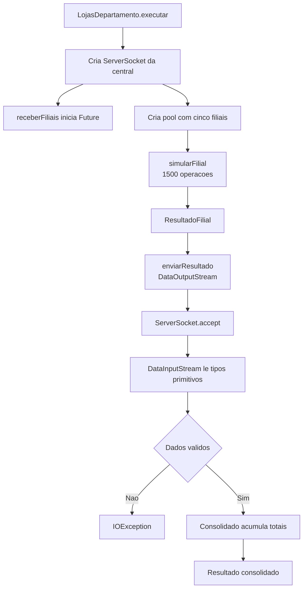

# Consolidacao Distribuida de Lojas

## Visao Geral

Esta atividade simula cinco filiais que processam compras e vendas e enviam
os totais para uma central por TCP. O objetivo é demonstrar tarefas concorrentes,
serialização binária de dados primitivos e consolidação distribuída.

## Tecnologias e Ferramentas

- Java SE e JDK 8 ou superior
- `ServerSocket` e `Socket`
- `DataInputStream` e `DataOutputStream`
- `ExecutorService`, `Callable` e `Future`
- `ThreadLocalRandom`
- `LockSupport`

## Como foi Solucionado (Resumo Tecnico)

`executar` cria uma central em porta dinâmica e pools para central e filiais.
Uma tarefa submetida ao pool executa `receberFiliais`. Cinco tarefas filiais
chamam `simularFilial`.

`simularFilial` realiza 1500 operações por filial. Cada operação gera um valor
aleatório entre 10 e 1000 e escolhe aleatoriamente compra ou venda. Um atraso
nanosegundo curto simula o tempo da operação.

`enviarResultado` abre um `Socket` ativo e usa `DataOutputStream` para enviar,
nesta ordem, identificador da filial, total de compras, total de vendas e número
de transações. `receberFiliais` aceita as cinco conexões com `accept`,
reconstrói os dados com `DataInputStream`, valida valores e soma em
`Consolidado`.

## Diagrama da Solucao (com Funcoes)



## Como Executar

Na raiz do repositório:

```powershell
javac -encoding UTF-8 -d out src\Main.java src\Exercicio05_LojasDepartamento\LojasDepartamento.java
java -cp out Main
```

Escolha a opção `5` no menu principal.
