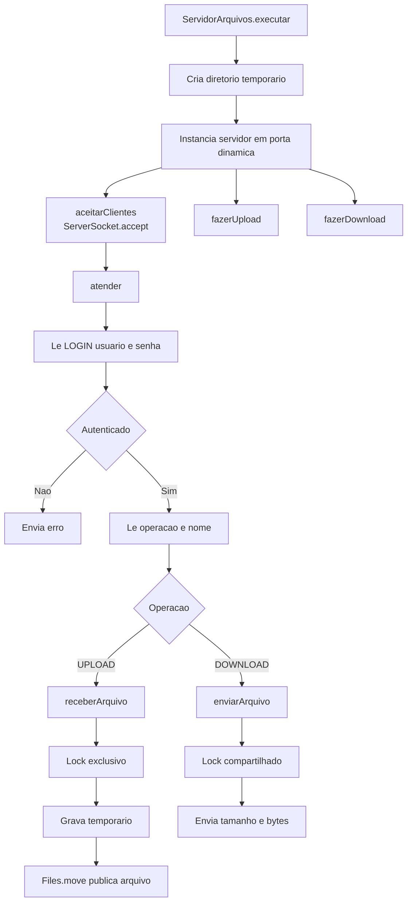

# Servidor TCP de Arquivos

## Visao Geral

Esta atividade demonstra login e transferências de arquivos por TCP. O sistema
realiza upload e download, valida nomes e tamanhos e controla acesso simultâneo
por arquivo com locks de leitura e escrita.

## Tecnologias e Ferramentas

- Java SE e JDK 8 ou superior
- `ServerSocket` e `Socket`
- `DataInputStream` e `DataOutputStream`
- Java NIO e `Files`
- `ConcurrentHashMap`
- `ReentrantReadWriteLock`
- `ExecutorService`

## Como foi Solucionado (Resumo Tecnico)

`executar` cria um diretório temporário, instancia `ServidorArquivos` em porta
dinâmica e demonstra `fazerUpload` seguido de `fazerDownload`. `aceitarClientes`
recebe conexões TCP e executa `atender` em uma thread do pool.

`atender` exige primeiro `LOGIN`, usuário `aluno` e senha `socket`. Depois lê
`UPLOAD` ou `DOWNLOAD` e valida nomes com uma expressão que permite letras,
números, ponto, sublinhado e hífen.

`receberArquivo` rejeita tamanhos negativos ou maiores que 50 MiB. Adquire o
lock exclusivo do nome, grava um arquivo temporário e usa `Files.move` para
publicar o arquivo final. `enviarArquivo` adquire o lock compartilhado, envia o
tamanho e escreve os bytes.

## Diagrama da Solucao (com Funcoes)



## Como Executar

Na raiz do repositório:

```powershell
javac -encoding UTF-8 -d out src\Main.java src\Exercicio06_ServidorArquivos\ServidorArquivos.java
java -cp out Main
```

Escolha a opção `6` no menu principal.

As credenciais da demonstração são `aluno` e `socket`.
