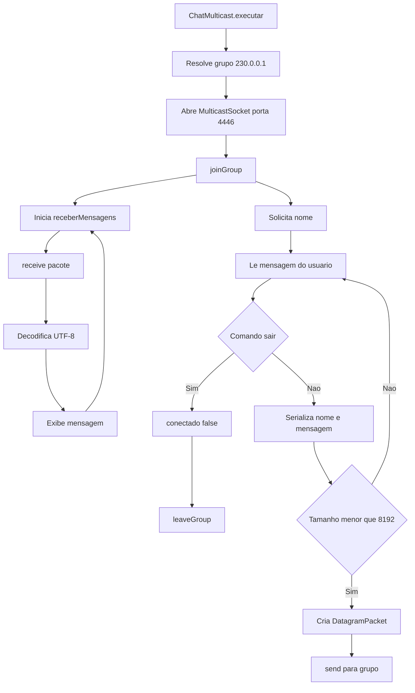

# Chat UDP Multicast

## Visao Geral

Esta atividade implementa um participante de chat usando UDP multicast. Todos
os processos que entram no mesmo grupo podem receber os datagramas enviados
pelos demais participantes, sem manter conexões persistentes.

## Tecnologias e Ferramentas

- Java SE e JDK 8 ou superior
- `MulticastSocket`
- `DatagramPacket`
- UDP multicast
- UTF-8
- `AtomicBoolean`
- Threads Java

## Como foi Solucionado (Resumo Tecnico)

`executar` resolve o endereço `230.0.0.1` e cria um `MulticastSocket` na porta
`4446`. `joinGroup` faz o participante entrar no grupo. Uma thread executa
`receberMensagens`, recebendo continuamente os pacotes pelo método `receive`.

O usuário informa um nome e digita mensagens. `executar` verifica o limite de
8192 bytes, serializa `nome: mensagem` em UTF-8 e chama `send` com um
`DatagramPacket` destinado ao grupo e à porta.

O comando `/sair` encerra o envio, altera `conectado` para `false` e executa
`leaveGroup` para remover o participante do grupo.

## Diagrama da Solucao (com Funcoes)



## Como Executar

Na raiz do repositório:

```powershell
javac -encoding UTF-8 -d out src\Exercicio07_ChatMulticast\ChatMulticast.java
java -cp out Exercicio07_ChatMulticast.ChatMulticast
```

Como `ChatMulticast` não possui um método `main`, execute-o pelo menu principal:

```powershell
javac -encoding UTF-8 -d out src\Main.java src\Exercicio07_ChatMulticast\ChatMulticast.java
java -cp out Main
```

Escolha a opção `7`. Para testar a comunicação entre processos, execute o
programa em dois ou mais terminais na mesma rede que permita o tráfego UDP
multicast. Digite `/sair` para voltar ao menu.
